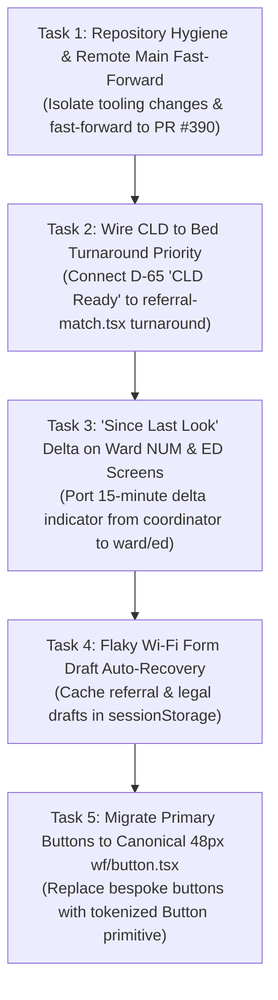

# Ward Flow Handover: 5 Prioritized Implementation Tasks

_Updated 2026-10-17 — Handover brief for next session; Documentation owns._

> **Target Repository:** `BigSimmo/Ward-Flow`  
> **Prepared For:** Successor Engineering Agent / Next Cloud Session  
> **Date:** 17 October 2026  
> **Clinical Product Owner:** Dr Josh (Psychiatrist, WA Health Context)  
> **Operating Mode:** 100% Synthetic Data Only (Prototype Operating Mode, approved 3 October 2026)

---

## 1. Executive Summary & Clinical Background

Ward Flow coordinates psychiatric inpatient bed allocation, emergency department (ED) referrals, custodial transport, and patient movements across Western Australia. It serves 23 psychiatric inpatient units and 8 metropolitan emergency departments (EDs), eliminating the multi-hour manual "phone-around" previously required to place an acute patient.

### Inviolable Governance & Clinical Safeguards

1. **100% Synthetic Data:** Never input, invent, or log real patient identifiers (no real Australian names, UMRNs, dates of birth, or clinical histories). All testing and mockups must execute against synthetic data only.
2. **Clinical Autonomy (WA Health AI Policy MP 0193/25):** The system **proposes**, a human **confirms or overrides**. Nothing auto-allocates; timeouts never default a bed placement. All overrides record a mandatory clinical rationale.
3. **Mental Health Act 2014 Destination Gate:** ED detention under Form 3A/3B pending psychiatric examination is lawful and normal. The statutory requirement for an "Authorised Hospital" bites strictly on the **receiving destination**, never on the waiting location.
4. **Focused Local Testing:** Always run focused vitest suites directly via `npx vitest run <path/to/test.ts>` (~100–250ms). Do not run heavy whole-suite locks unless authorized.

---

## 2. Current Repository Baseline

- **Base Revision:** `origin/main` at commit `6358371c` (`Fix clean installs and isolate Vitest caches (#390)`).
- **Recent Landed Milestones:**
  - **Criteria-Led Discharge (CLD) Live in Production (D-64, D-65, PRs #383, #387):** The `top25-criteria-led-discharge` feature flag is active across production, demo, and development. CLD chips (`CLD ready`, `CLD 2/5`) render on bed tiles, and treating psychiatrists can enter up to three patient-specific typed criteria matching WACHS form MR28.
  - **Workstation 12-Hour Session Lockout (PR #389):** Enforces ISM-0428 session termination for shared clinical workstations.
  - **AWOL Bed Hold Review Paused (D-65):** Stored behind `awol-bed-hold-review` (off everywhere) pending clinical review by Dr Josh.
- **Local Working Tree:** 8 modified files and 1 untracked test file (`scripts/run-vitest.mjs`, `scripts/pre-commit-checks.mjs`, `tests/vitest-result-reuse.test.ts`, docs). All 38 pre-commit tests pass cleanly.

---

## 3. The 5 Prioritized Tasks



---

### Task 1: Repository Hygiene & Remote Main Fast-Forward

- **Objective:** Isolate uncommitted developer tooling improvements onto a feature branch and fast-forward local `main` to `origin/main`.
- **Action Steps:**
  1. Inspect status: `git status`.
  2. Create a clean feature branch for the tooling changes:
     ```bash
     git checkout -b tooling/vitest-result-reuse
     git add scripts/run-vitest.mjs scripts/pre-commit-checks.mjs scripts/run-heavy.mjs tests/pre-commit-checks.test.ts tests/vitest-result-reuse.test.ts AGENTS.md README.md docs/agents/shared-context-and-memory.md docs/ward-flow/HOW-WE-WORK.md
     git commit -m "chore(tooling): support memoised reporters in run-vitest and add result-reuse tests"
     ```
  3. Return to `main` and fast-forward cleanly:
     ```bash
     git checkout main
     git pull --ff-only origin main
     ```
- **Acceptance Criteria:** `git status` on `main` is completely clean and matches `origin/main` at commit `6358371c`.

---

### Task 2: Wire Criteria-Led Discharge (CLD) to Bed Turnaround Priority

- **Clinical Purpose:** Now that D-65 has activated Criteria-Led Discharge in production, beds occupied by patients marked "CLD Ready" or departing can immediately trigger turnaround prioritization for waiting ED patients. Staging custodial transport in lockstep with terminal cleaning shaves 45–90 minutes off emergency department boarding times.
- **Target File:** `src/components/ward-management/referrals/referral-match.tsx:2111-2118`.
- **Current Gap:** The button `Flag Turnaround Priority` exists in `referral-match.tsx` but is disabled with an inert tooltip:
  `"Turnaround prioritisation is unavailable: no supported scheduling workflow is recorded here."`
- **Implementation Plan:**
  1. In `src/components/ward-management/ward-discharge-criteria.ts`, export a helper `unitHasCldReadyDeparture(unitId: string, admissions: readonly Admission[]): boolean` that returns `true` when an admitted patient has met all discharge criteria or is marked `CLD ready`.
  2. In `referral-match.tsx`, when a candidate unit has a CLD-ready patient or a departing bed release:
     - Activate the `Flag Turnaround Priority` button.
     - On click, dispatch `FLAG_MOVEMENT_TURNAROUND_PRIORITY` (or record the turnaround preference in the movement state).
     - Surface a badge on the coordinator's queue: `"Turnaround Candidate: Bed clearing via Criteria-Led Discharge"`.
  3. Author a focused vitest test: `tests/ward-cld-turnaround-priority.test.ts`.
- **Verification Command:** `npx vitest run tests/ward-cld-turnaround-priority.test.ts`.

---

### Task 3: Extend "Since Last Look" 15-Minute Diffs to Ward NUM & ED Screens

- **Clinical Psychology Purpose:** Ward Nurse Unit Managers (NUMs) and ED Liaison Nurses are frequently interrupted by clinical emergencies, code blacks, and ward rounds. A 15-minute delta tracker eliminates cognitive disorientation and prevents missed referrals when clinicians return to their workstations.
- **Source Component:** `src/components/ward-management/coordinator/since-last-look-panel.tsx` and `useSinceLastLook`.
- **Target Files:**
  - Ward NUM View: `src/components/ward-management/ward/ward-screen.tsx`.
  - ED Liaison View: `src/components/ward-management/ed/ed-screen.tsx`.
- **Implementation Plan:**
  1. Mount `useSinceLastLook` in `ward-screen.tsx`, scoped to the ward's own arrivals, releases, and incoming referrals.
  2. Render a subtle, non-intrusive pill in the header toolbar (e.g. `2 updates since 14:15`).
  3. Clicking the pill toggles `SinceLastLookSheet`, highlighting recent changes.
  4. Ensure opening the sheet marks items as reviewed and dismisses the badge without full-page re-renders.
  5. Mount the equivalent scoped pill in `ed-screen.tsx` for ED referral status updates and transport arrivals.
- **Verification Command:** `npx vitest run tests/ward-since-last-look.dom.test.tsx`.

---

### Task 4: Flaky Wi-Fi Form Draft Auto-Recovery (`sessionStorage`)

- **Clinical Ergonomics Purpose:** Emergency department basements have notorious Wi-Fi dropouts. Prevent clinicians from losing partially entered MHA Form 1A referrals during browser reloads or disconnects.
- **Target Files:**
  - `src/components/ward-management/use-dirty-state-guard.ts`
  - `src/components/ward-management/referrals/referral-intake.tsx`
  - `src/components/ward-management/legal-forms/legal-forms-screen.tsx`
- **Implementation Plan:**
  1. Enhance `useDirtyStateGuard` with an optional `storageKey` parameter.
  2. When enabled, serialize form values into `window.sessionStorage` on debounce (500ms).
  3. On component mount, check if an unsubmitted draft exists; if so, populate initial values and show a small prompt: _"Draft restored from this session — [Clear]"_.
  4. Upon successful form submission, explicitly clear the `sessionStorage` key.
  5. Privacy Guard: Ensure typed drafts never persist across browser closes and are cleared on sign-out.
- **Verification Command:** Author and run `tests/ward-draft-recovery.test.ts`.

---

### Task 5: Migrate Primary Placement Buttons to Canonical 48px `src/components/wf/button.tsx`

- **Design System Purpose:** Replace fragile, bespoke CSS button classes with the accessible, tokenized button primitive featuring guaranteed 48px touch targets, loading spinners, and built-in `disabledReason` tooltips.
- **Canonical Primitive:** `src/components/wf/button.tsx`.
- **Target Files:**
  - Candidate shortlist cards in `src/components/ward-management/coordinator/candidate-card.tsx` (or `referral-match.tsx`).
  - Ward intake action buttons in `src/components/ward-management/ward/ward-screen.tsx`.
- **Implementation Plan:**
  1. Replace raw `<button>` elements for **Accept Referral**, **Pull Patient**, and **Decline** with `<Button variant="pri" size="md">` and `<Button variant="sec" size="md">`.
  2. For unavailable actions, pass `disabledReason="Waiting on Form 1A medical clearance"` to render accessible tooltips instead of silent disabled buttons.
  3. Verify touch targets remain `>= 48px` on mobile/tablet viewports per `--ward-tap`.
- **Verification Command:** `npx vitest run tests/ward-wf-v10-parts.dom.test.tsx tests/ward-style-drift-ratchet.test.ts`.

---

## 4. Verification & Handoff Checklist

Before considering this milestone complete, the incoming agent must confirm:

- [ ] Local `main` is clean and fast-forwarded to `origin/main` (`6358371c`).
- [ ] `Turnaround Priority` is clickable and active when an admission has met CLD criteria.
- [ ] `Since Last Look` pill renders cleanly in Ward and ED headers without layout shifts.
- [ ] Form drafts survive a manual page refresh in `referral-intake.tsx`.
- [ ] Primary placement buttons on Ward and Coordinator views use `src/components/wf/button.tsx` with 48px touch targets.
- [ ] Zero regressions across affected Vitest suites (`npx vitest run <paths>`).
