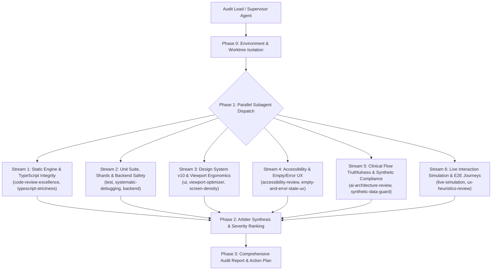

# Full Repository Parallel & Subagent Audit Implementation Plan

> **For agentic workers:** REQUIRED SUB-SKILL: Use superpowers:subagent-driven-development (recommended) or superpowers:executing-plans to implement this plan task-by-task. Steps use checkbox (`- [ ]`) syntax for tracking.

**Goal:** Conduct an exhaustive, multi-domain, parallel subagent audit of the entire Ward Flow codebase to detect all bugs, regressions, architectural flaws, accessibility gaps, clinical flow inconsistencies, and UX friction points without risking workspace disruption.

**Architecture:** A coordinated 6-stream parallel subagent panel dispatched across isolated problem domains, synthesizing findings through an Arbiter into a unified, severity-ranked audit report (`docs/ward-flow/reports/2026-10-11-full-repository-audit.md`).

**Tech Stack:** Next.js 15+ (App Router), React 19, TypeScript (strict mode), CSS Modules & Tailwind, Vitest (Node + JSDOM), Playwright (Chromium E2E shards), Chrome DevTools MCP.

**Spec Reference:** [`docs/ward-flow/README.md`](file:///d:/Repos/Ward-Flow/docs/ward-flow/README.md), [`docs/ward-flow/AUDIT-AND-RECOMMENDATIONS-2026-10-09.md`](file:///d:/Repos/Ward-Flow/docs/ward-flow/AUDIT-AND-RECOMMENDATIONS-2026-10-09.md), [`AGENTS.md`](file:///d:/Repos/Ward-Flow/AGENTS.md).

---

## Global Constraints

- **100% Synthetic Data Only:** Zero live EHR calls, zero real patient information (PII/PHI), strict adherence to [`synthetic-data-guard.ts`](file:///d:/Repos/Ward-Flow/src/lib/synthetic-data-guard.ts).
- **Workspace Isolation:** Any investigative runs or test execution that mutate local artifacts must occur in an isolated worktree branched from canonical `origin/main` (`1158c095`), preserving local uncommitted work in `D:\Repos\Ward-Flow`.
- **Truthful Denominators ("Stop the claim, keep the facts"):** No computed phantom ready beds, no unverified legal expiry predictions, and explicit distinction between "unrecorded" and "zero".
- **Clinician-in-the-Loop:** Bed allocations and transfers are decision-support illuminations; algorithmic automation must never override clinical gatekeeping.
- **Resource Discipline:** Bound test runs to prevent machine freeze; use narrow Vitest invocations and targeted Playwright journeys.

---

## Review Focus

1. **Stale Local State vs Upstream Canonical Drift:** The local checkout is 313 commits behind `origin/main` on `feat/movement-drawer-audit-and-actions`. The audit must clearly delineate between local branch defects and upstream `origin/main` defects.
2. **Sheet / Drawer Focus Leaks & Trapping Failures:** In complex screens (`ward-screen.tsx`, `community-screen.tsx`, `referral-board.tsx`), sheets must trap focus, handle Escape dismissal cleanly, and restore focus to trigger elements without scrolling the body.
3. **Emergency FIFO Triage & Transfer Gate Integrity:** Verify Decision D-30 (Central coordinator inter-ward transfer gate) and Decision D-32 (Emergency FIFO queue triage ordering without artificial priority inversion).
4. **WCAG 2.1 AA & Forced Colors / High Contrast:** Audit 45 route pages for 4.5:1 text contrast, accessible button names (`aria-label`), keyboard operability, and Windows High Contrast support.
5. **Empty & Error State Resilience:** Audit all 45 routes for missing or blank states when search yields 0 records, filters are exhausted, or network degradation occurs.

---

## Task Structure & Subagent Stream Allocation

---

### Phase 0: Workspace & Worktree Isolation

#### Task 0.1: Establish Isolated Audit Worktree from `origin/main`
**Files:**
- Create: `D:/Worktrees/WardFlow/repo-audit-20261011`
- Read: `package.json`, `package-lock.json`

**Steps:**
- [ ] 1. Verify `git remote get-url origin` points to `BigSimmo/Ward-Flow`.
- [ ] 2. Create isolated worktree: `git worktree add D:/Worktrees/WardFlow/repo-audit-20261011 origin/main`.
- [ ] 3. Validate clean lockfile parity and engine constraints (`npm run check:installed-lock-parity`).
- [ ] 4. Confirm isolated server URL allocation (`npm run ensure`).

---

### Phase 1: Parallel Subagent Execution (6 Concurrent Streams)

#### Task 1: Stream 1 — Static Engine, TypeScript Strictness & Linter Audit
**Subagent Type:** `research` or `self`  
**Role:** Static Analysis & TypeScript Specialist  
**Assigned Scope:** Entire `src/` directory, `tsconfig.json`, `eslint.config.mjs`, `bundle-budget.json`  
**Key Skills:** `code-review-excellence`, `typescript-strictness-review`

**Steps:**
- [ ] 1. Run typecheck across the whole repository: `npm run typecheck:ci`. Record all TypeScript compile errors.
- [ ] 2. Run static linter: `npm run lint`. Record all ESLint violations across components, tests, and scripts.
- [ ] 3. Audit for illegal `any`, implicit type coercions, and unsafe type assertions (`as unknown as`) across `src/components/ward-management/`.
- [ ] 4. Check dead code candidates and circular imports: `node scripts/check-dead-code.mjs` (if available) and review unused exports.
- [ ] 5. Audit bundle budget compliance against `bundle-budget.json` thresholds.
- [ ] 6. Output stream findings into `tmp/audit-stream1-static.json`.

---

#### Task 2: Stream 2 — Unit Suite, Regression Safety & Backend Audit
**Subagent Type:** `research` or `self`  
**Role:** Test Architecture & Backend Specialist  
**Assigned Scope:** `tests/`, `backend/ward-flow/`, `vitest.config.mts`  
**Key Skills:** `test`, `systematic-debugging`, `testing-anti-patterns`

**Steps:**
- [ ] 1. Run backend test suite: `npm run test:backend` (`backend/ward-flow/backend.test.mjs`). Record any failures or SQL schema mismatches.
- [ ] 2. Run core unit tests in isolation across shards: `npx vitest run tests/` (evaluating node and jsdom projects).
- [ ] 3. Audit for skipped, quarantined, or silently ignored tests across `tests/`.
- [ ] 4. Verify test runner isolation and cache safety: run `npx vitest run tests/ci-cache-safety.test.ts` and `tests/test-runner-safety.test.ts`.
- [ ] 5. Identify slow or timing-out test specs that cause shard imbalance.
- [ ] 6. Output stream findings into `tmp/audit-stream2-tests.json`.

---

#### Task 3: Stream 3 — Design System v10 & Responsive Viewport Ergonomics
**Subagent Type:** `research` or `self`  
**Role:** UI/UX & Responsive Layout Specialist  
**Assigned Scope:** 45 route pages in `src/app/mockups/ward-flow/`, CSS Modules in `src/components/`, tokens in `src/styles/` or `src/app/globals.css`  
**Key Skills:** `ui`, `viewport-optimizer`, `screen-density-tuning`, `design-system-contract`

**Steps:**
- [ ] 1. Audit CSS modules for hardcoded magic numbers, invalid hex codes, or unapproved token overrides.
- [ ] 2. Audit responsiveness across Mobile Phone (375px/390px), Tablet (768px), and Desktop (1280px+).
- [ ] 3. Verify phone bottom dock choreographies (`mobile-dock-choreographer`) to prevent software keyboard collisions.
- [ ] 4. Check Prototype Pill header consistency and breadcrumbs across all 45 routes following PR #246 (`Prototype banner becomes a pill`).
- [ ] 5. Audit for horizontal scrolling (unintended `overflow-x`) on narrow viewports.
- [ ] 6. Output stream findings into `tmp/audit-stream3-design.json`.

---

#### Task 4: Stream 4 — Accessibility (WCAG 2.1 AA) & Empty/Error State UX
**Subagent Type:** `research` or `self`  
**Role:** Accessibility & User Resilience Specialist  
**Assigned Scope:** `src/components/ui/`, `src/components/ward-management/`, `tests/ui-ward-forced-colors.spec.ts`  
**Key Skills:** `accessibility-review`, `empty-and-error-state-ux`, `focus-restore-orchestrator`, `theme-contrast-auditor`

**Steps:**
- [ ] 1. Audit all modal dialogs, drawers, and sheets (`sheet.tsx`, `ward-modal-focus.ts`) for focus trapping, Esc key dismissal, and focus restoration to the trigger button.
- [ ] 2. Audit interactive buttons for accessible names (`aria-label`, visible text), explicit `type="button"`, and non-inert keyboard access.
- [ ] 3. Run forced-colors / high-contrast test: `npx playwright test tests/ui-ward-forced-colors.spec.ts`.
- [ ] 4. Check color contrast ratios across dark/light modes (minimum 4.5:1 text, 3:1 graphical objects).
- [ ] 5. Audit empty states across all screens: zero search results, cleared filter sets, empty patient lists, unallocated transfer queues.
- [ ] 6. Audit error states: network degradation handling, offline warning banners, and human-friendly retry actions.
- [ ] 7. Output stream findings into `tmp/audit-stream4-a11y.json`.

---

#### Task 5: Stream 5 — Clinical Flow Truthfulness & Synthetic Data Compliance
**Subagent Type:** `research` or `self`  
**Role:** Clinical Flow & Data Governance Specialist  
**Assigned Scope:** `src/lib/synthetic-data-guard.ts`, `src/components/ward-management/coordinator/`, `src/components/ward-management/referrals/`, `src/components/ward-management/ward/`  
**Key Skills:** `ai-architecture-review`, `synthetic-data-compliance-review`, `ux-heuristics-review`

**Steps:**
- [ ] 1. Audit Decision D-30: Verify Central Coordinator inter-ward transfer approval gates. Ensure bedside staff cannot bypass coordinator gatekeeping.
- [ ] 2. Audit Decision D-32: Verify Emergency FIFO queue triage ordering. Ensure referrals maintain truthful First-In, First-Out sequence without algorithmic priority warping.
- [ ] 3. Audit Truthful Denominators: Ensure no computed legal expiry deadlines are displayed without underlying clinical data ("Stop the claim, keep the facts").
- [ ] 4. Run synthetic data scanner: verify zero real patient names, UR numbers, Medicare numbers, or live hospital EHR calls.
- [ ] 5. Verify WA Health mental health catchments (FSH, SCGH, Graylands, RPH, Bentley, Midland, Rockingham) and specialized services (Mother & Baby, Older Adult, Youth/Adolescent).
- [ ] 6. Output stream findings into `tmp/audit-stream5-clinical.json`.

---

#### Task 6: Stream 6 — Live Interaction Simulation & E2E Browser Journey Health
**Subagent Type:** `research` or `self`  
**Role:** Browser Simulation & E2E Specialist  
**Assigned Scope:** `tests/ui-ward-*.spec.ts`, Playwright configurations, `scripts/playwright-pr-shards.mjs`  
**Key Skills:** `live-simulation`, `ux-review`, `nav-graph-reviewer`

**Steps:**
- [ ] 1. Start isolated local dev server via `npm run ensure` and confirm health on `/api/local-project-id`.
- [ ] 2. Run Playwright critical journey tests: `npm run test:e2e:critical`.
- [ ] 3. Run full ward journey tests: `npm run test:e2e:ward-journeys`.
- [ ] 4. Simulate complete multi-step clinician journeys via headless interaction:
  - Patient search -> Dossier drawer opening -> Bed status toggle -> Discharge initiation.
  - Emergency referral receipt -> Coordinator triage -> Ward assignment -> Transfer complete.
- [ ] 5. Test browser back/forward navigation and deep-link query parameter state preservation.
- [ ] 6. Identify any flaky, hanging, or slow browser tests.
- [ ] 7. Output stream findings into `tmp/audit-stream6-journeys.json`.

---

### Phase 2: Arbiter Synthesis & Severity Ranking

#### Task 7: Aggregate, Deduplicate & Prioritize Findings
**Files:**
- Create: `docs/ward-flow/reports/2026-10-11-full-repository-audit.md`
- Read: `tmp/audit-stream*.json`

**Steps:**
- [ ] 1. Collect and parse JSON outputs from all 6 subagent streams.
- [ ] 2. Deduplicate findings where static, unit, and E2E failures overlap.
- [ ] 3. Categorize each defect into standard severity tiers:
  - **P0 — Blocker:** Crashing routes, data corruption, broken build/typecheck, synthetic data breach.
  - **P1 — Clinical / Functional:** Broken transfer gates, incorrect triage ordering, inaccessible modal traps, failing critical journeys.
  - **P2 — UX / Ergonomics:** Layout shifts, responsive clipping, missing empty state feedback, contrast warnings.
  - **P3 — Code Hygiene / Tech Debt:** Unused exports, deprecated types, loose assertions, test shard latency.
- [ ] 4. Draft concrete, reproducible reproduction steps and recommended fixes for every identified issue.

---

### Phase 3: Deliverable & Action Roadmap

#### Task 8: Deliver Comprehensive Audit Report & Remediation Recommendations
**Files:**
- Finalize: `docs/ward-flow/reports/2026-10-11-full-repository-audit.md`
- Update: `docs/ward-flow-task-ledger.md`

**Steps:**
- [ ] 1. Write the final audit report with executive summary, metric scorecard, and prioritized remediation backlog.
- [ ] 2. Present findings clearly to Josh in plain English, highlighting immediate high-value fixes.
- [ ] 3. Propose batched remediation PRs grouped by domain (e.g., A11y & Focus fixes, TypeScript cleanup, E2E stabilization).
