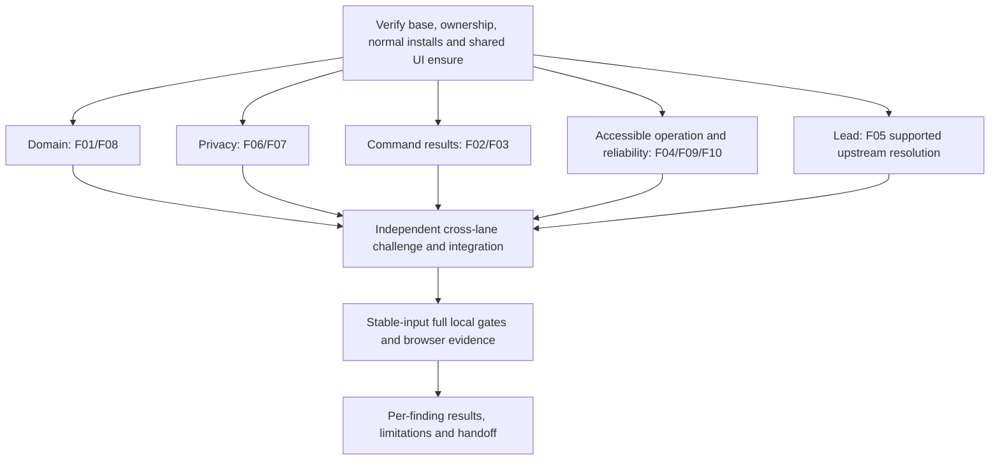

# Full repository audit remediation implementation plan

> **For agentic workers:** Use the existing parallel implementation lanes with the coordinator applying the executing-plans, systematic-debugging and test-first workflows. Do not recursively spawn workers. Steps use checkbox syntax. The user explicitly requested both the plan and implementation; no additional routine plan approval is required.

**Goal:** Correct the ten confirmed findings from the Full Deep audit, preserve current synthetic-prototype behaviour and provide independently reviewed local verification.

**Architecture:** Retain the shared reducer/engine, validated transport contracts and existing settled-command APIs. Four lanes own disjoint files in one isolated task worktree; the coordinator controls dependency setup, file claims, expensive checks and final integration. A second review wave challenges each consequential change without relying on its author's conclusion.

**Tech stack:** Next.js/React/TypeScript, Vitest DOM and node projects, Playwright, provider-neutral Node backend and optional disposable local PostgreSQL.

**Spec:** [Remediation requirements](2026-10-18-full-audit-remediation-spec.md), based on recorded Full Deep findings F01–F10 from the same conversation, revalidated against source initially at `2c37e5ae171514d5b16513512b4a52b32ab9d5d0`, then revalidated on verified main `aa3a78b9ecfd1132a7ff48867bac5f1d366dbccc`. The original `/tmp` audit files are absent in this execution environment and cannot be claimed as freshly inspected evidence. Maintained owner decisions and public contracts override recommendations if they conflict.

## Global constraints

- Repository `BigSimmo/Ward-Flow`; original `/workspace/Ward-Flow` remains intact. Task branch `codex/full-audit-remediation-20261017`, isolated worktree `/workspace/wardflow-remediation`.
- Only synthetic data. No patient names or typed record text in URLs, logs, screenshots or messages. Use coded sentinel fixtures and sanitised result summaries.
- No provider operations, migrations on remote databases, hosted CI, publishing, PRs, pushes, production writes, deployment or spending. The user approved the read-only main fetch; it succeeded. No further provider operations are authorised.
- Before edits: verify main base, read applicable instructions, run the ownership checker and append exact claims to `/workspace/wardflow-remediation-private/sign-out.md`. One shared log serves all lanes. Do not edit another lane's files.
- No schema weakening, event-permission weakening, reduced assertions, higher timeouts, quarantine, hidden test exclusions or lowered budgets/floors.
- Preserve the accepted appearance, synthetic disclosure, privacy fences, explicit confirmation provenance, server revision/receipt semantics and intentional frozen reports within a valid context.
- Use existing abstractions. No speculative redesign, broad refactor or new provider. Fix new defects in affected code when reproduced; keep unverified audit concerns labelled as such.
- Reproduce behavioural defects before patching, record focused red/green evidence, then run selected shared gates once on stable inputs.
- Keep recoverable local checkpoints. The selected FULL gate requires a clean committed tree, so the coordinator will make an ordinary guarded local task-branch commit after review/static checks. This is part of local implementation; publication stages remain separately authorised.

## Review focus

1. Same-generation role/account/scope changes while a report is hidden or a snapshot timer is pending must never expose its previous broader pack; ordinary navigation must retain an intentional frozen pack.
2. Another actor's insertion or an old rejection must never count as this registration's result; refused registration must preserve its draft and remain retryable.
3. A deliberately partial referral must persist its allowed targets exactly once while denied targets stay denied; all-denied, malformed, stale or unauthorized commands must remain refusals.
4. Refused, failed, cancelled or delayed actions and denied/unavailable clipboard APIs must never show success; existing per-role authorization stays effective.
5. Keyboard focus/activation must work at endpoints, after dismissal and after selection; date fixtures must exercise nonempty red/nonred populations and a legitimate empty week independently of the real day.

## Waves and dependency graph

Only the coordinator runs wide suites, production builds, dependency changes, local database fixtures or shared services. Each worker runs focused selected tests through the maintained lease/slot wrapper after coordination; no full-suite duplication. Reviewers return findings to the original owner, who fixes within the same claim. Four implementation lanes are the first swarm; bounded independent security/domain/UI/integration review is the second, not a recursive swarm.

## Task 0: Setup and preserved source — lead

- [x] Verify original branch/head/clean state and Ward Flow origin fetch/push identity. Local source has documented main-line ancestry and main-only fetch refspec; the remote main reference was subsequently refreshed with explicit approval.
- [x] Create isolated task branch/worktree, private checkpoint and actual group ownership log. Preserve old prunable worktree metadata; do not delete any prior worktree.
- [x] Perform normal exact-lock root/backend installs with lifecycle scripts. Root wrote trusted installed-byte stamp; no source dependency edits.
- [x] Resolve pending main-base verification answer. If read-only fetch is authorised, run exactly `git fetch origin main`, identify source drift and coordinate the actual base before editing. If the user chooses the audited snapshot exception, record that scoped exception explicitly and never claim remote freshness.
- [x] Run exact-file ownership checks, append claims and grant lane edit authority. Read installed Next client-component guidance before writing React changes.
- [x] Run `npm run ensure`, verify `/api/local-project-id`, record the actual project URL, share it with workers and reconcile any generated instruction banner separately.

Stopping condition: accessible accepted base, clear ownership, valid dependencies and usable UI evidence or a precisely reported startup blocker. Setup failure never authorises bypassing guards.

## Task 1: F01 capacity confirmation provenance — DOMAIN

**Files:** `src/components/ward-management/capacity/planned-admissions-reducer.ts`; `tests/ward-planned-admissions.test.ts`.

**Interfaces:** Preserve `wardFlowReducer`/planned conversion event and existing capacity structures. No new public API. A conversion decrements the same counts but does not replace either `confirmedAt` or `confirmedBy`; only the existing explicit confirmation event renews that provenance.

- [x] Add a valid conversion regression with distinct prior confirmation stamps/by values and a nontrivial event time. Assert correct patient/admission/planned status/count/mix changes, unchanged stamps and current-state validity.
- [x] Run that assertion before code changes and record the timestamp mismatch failure.
- [x] Remove only synthetic renewal of confirmation metadata from conversion; preserve eligibility and allocation arithmetic.
- [x] Re-run complete planned-admission tests and direct conversion/capacity consumers, including stale/capacity-refusal and explicit confirmation controls.

Acceptance: converting an arrival cannot make old ward capacity look freshly confirmed; genuine explicit confirmation still does.

## Task 2: F08 shared partial referral contract — DOMAIN

**Files:** `backend/ward-flow/engine.ts`; `tests/ward-shared-backend-contract.test.ts`.

**Interfaces:** Preserve accepted/refused transport outcome shape, command validation and domain `partial` audit outcome with accepted/denied target details. PostgreSQL/client consumers must still recognise a committed command; do not introduce unsupported top-level `partial` transport values.

- [x] Use existing valid mixed-target fixtures to assert source state/command validity, local reducer partial outcome, and equivalent shared-engine persisted allowed subset.
- [x] Add all-valid and all-denied controls; include mocked local HTTP revision increment, replay and stale-revision cases with no provider calls.
- [x] Confirm the mixed-target regression fails because the engine returns the original state.
- [x] Admit only a corresponding deliberately partial `REFER_TO_UNITS` result backed by its new audit/target outcome; retain blanket refusal for other rejection-bearing commands.
- [x] Re-run shared backend contracts and affected domain/audit/permission suites. Lead rebuilds the actual backend bundle before backend checks.

Acceptance: permitted target state/audit/revision is durable exactly once; unsuitable targets stay denied; all-denied/malformed/unauthorised/stale cases never commit. This does not assert a current normal UI emitter unless observed.

## Task 3: F06 counts-only executive projection — PRIVACY

**Files:** `src/components/ward-management/ward-access-scope.ts`; `src/components/ward-management/ward-access-state.ts`; `tests/ward-access-state.test.ts`.

**Interfaces:** Preserve `scopeWorkspace`/`scopeWardFlowState`/backend `scopeWorld` contracts, valid shared wire state and existing aggregate selectors. Build appropriate explicit executive field projections using existing safe projection patterns; no ad hoc deletion list that silently retains future free-text fields.

- [x] Seed coded sentinels into movement owner/blocker/history/transport/forms/overrides, referral narrative/history/corrections and patient-specific admission discharge criteria/follow-up metadata.
- [x] Assert the actual executive projection contains none of those sentinel values, remains a valid shared state, preserves safe counts and service exclusions, and leaves coordinator projection unchanged.
- [x] Observe the existing projection fail the sentinel assertions.
- [x] Implement field-built aggregate-safe movement/referral/admission projections consistent with owner D-59; inspect nested structures and map keys, not only direct fields.
- [x] Run access projection, engine response and executive statistics/report tests; lead includes the actual backend bundle and HTTP consumer checks.

Acceptance: the counts-only server response excludes typed narratives and person-specific clinical criteria, while authorised nonexecutive workflows and truthful aggregates remain intact.

## Task 4: F07 retained report access lifetime — PRIVACY

**Files:** `src/components/ward-management/reports/downtime-pack.ts`; `reports/downtime-pack-screen.tsx`; `reports/downtime-pack-context.tsx` (new under that full prefix); `src/components/ward-management/ward-shared-access.tsx`; `src/components/ward-management/shell/ward-access.tsx`; `tests/ward-reports-downtime.test.ts`; `tests/ward-reports-screens.dom.test.tsx`.

**Interfaces:** Extend cache read/write with a validated opaque context lifetime alongside existing `worldGeneration`. A small always-mounted context boundary supplies stable identity through ordinary route navigation and a new identity on effective access/account/session/preview/grant transitions. Screen reads must reject mismatches synchronously; an effect alone is insufficient.

- [x] Add same-generation broad-to-narrow, service/account/session change, offscreen remount, pending snapshot cancellation and print/render regressions, with ordinary navigation/clock-tick and generation-change controls.
- [x] Observe old generation-only cache return the broader pack.
- [x] Implement context-bound cache reads and lifecycle invalidation, cancel pending snapshot work when its context changes, and preserve intended freeze within a valid context.
- [x] Verify every production cache consumer supplies the context, no default fallback reopens the old lifetime, and the boundary is mounted above route changes but inside the hooks it consumes.
- [x] Run report/cache/shared-access/provider integration consumers. Independently review React render/effect timing and account-session boundaries.

Acceptance: stale broader reports never render/print under narrower authority; navigation within the same context still retains the deliberate snapshot.

## Task 5: F02 registration result correlation — FEEDBACK

**Files:** `src/components/ward-management/patients/add-patient.tsx`; `tests/ward-add-patient.dom.test.tsx`; `tests/ward-feedback-settlement.dom.test.tsx` (new, shared with next task).

**Interfaces:** Use existing `WardCommandDispatch`/`useWardRaise` settled outcomes. Capture the submitted synthetic identity/intake draft; only that command's accepted completion and matching unique created patient may navigate/start referral. Do not infer success or refusal from unrelated global array/rejection deltas.

- [x] Add repeated-refusal tests with an already-present unrelated refusal and own retry.
- [x] Add delayed own command plus unrelated inserted patient/conflict-shaped snapshot and own refusal; assert no wrong-patient selection/navigation, no draft loss, and retryability.
- [x] Add accepted-result/snapshot arrival ordering and submitted-draft drift controls.
- [x] Observe current false-success/stranded-refusal behaviour.
- [x] Implement correlation through the existing outcome API and captured submitted identity; guard unmount/context-lifetime effects without inventing a new transport API.
- [x] Run full add-patient and focused real-provider/shared-client consumers. Challenge real409 source closure separately from a synthetic handler seam.

Acceptance: only the actual submitted patient's accepted result produces completion; refusal and unrelated changes cannot masquerade as success.

## Task 6: F03 truthful action and clipboard completion — FEEDBACK

**Files:** `src/components/ward-management/delays/delays-screen.tsx`; `src/components/ward-management/governance-registers.tsx`; `src/components/ward-management/legal-forms/legal-forms-screen.tsx`; `src/components/ward-management/patients/patient-now-layouts.tsx`; `tests/ward-feedback-settlement.dom.test.tsx`.

**Interfaces:** Retain the existing settled command and permissions API. If a local governance helper needs a minimal settlement callback, define it locally and preserve existing consumers; no generic provider refactor.

- [x] Reproduce pending/refused/failed command feedback in actual escalation and endorsement handlers; add accepted controls and duplicate-click/draft-retention assertions.
- [x] Reproduce rejected/absent clipboard handling in both legal and patient-call controls; add resolved-copy control and preserve usable failure/retry feedback.
- [x] Await each action's own outcome, show success/close only after acceptance, preserve draft and clear pending on refusal/failure. Clipboard status follows its actual promise.
- [x] Run the focused handler suite plus existing delays/governance/legal/patient consumer tests.

Acceptance: no premature success, stale completion after lost context, unhandled clipboard rejection or accidental authorization widening. Source-only candidates are fixed only after meaningful reproduction.

## Task 7: F04 keyboard and semantic operation — ACCESSIBILITY

**Files:** `src/components/ward-management/shell/ward-rail.tsx`; `src/components/ward-management/discharges/discharge-detail-panes.tsx`; `tests/ward-rail-persona-sync.dom.test.tsx`; `tests/ward-discharge-detail-tabs.dom.test.tsx` (new).

**Interfaces:** Preserve appearance, persona/service selection contracts, existing Escape/phone-sheet precedence and disclosure copy. Properly connect per-instance tabs/panels using stable IDs and existing shared controls.

- [x] Add listbox opening/selected focus, ArrowUp/Down/Home/End, Enter/Space, Tab dismissal and selection/dismissal focus-return tests.
- [x] Add discharge roving ArrowLeft/Right/Home/End activation, tab/tabpanel accessible relationships and duplicate-instance ID checks. Retain phone release layout where no tabs are offered.
- [x] Observe the current missing keyboard/focus semantics failures.
- [x] Implement roving focus/activation and relationships without visual redesign or changing role permission rules.
- [x] Run the relevant DOM consumers; lead verifies live keyboard/DOM operation and desktop/phone geometry with safe screenshots.

Acceptance: all offered composites can be operated and understood from keyboard without leaving focus on hidden controls; no unsupported formal AT conformance claim.

## Task 8: F09/F10 accurate gate docs and deterministic weekly fixture — ACCESSIBILITY

**Files:** `docs/ward-flow/PUBLIC-CI.md`; `tests/ward-statistics-tone-and-dates.dom.test.tsx`.

- [x] Confirm required/reuse workflow dependencies from `.github/workflows/ward-flow.yml`; correct only the contradictory documentation, preserving workflow gates.
- [x] Preserve main's Saturday calendar pin; add a deliberate Perth Monday 12 October2026 populated fixture. Explicitly assert both red and nonred waits, not a vacuous row loop.
- [x] Add a legitimate empty previous-week fixture using Perth Sunday18October2026; assert zero/empty feedback and no fabricated list.
- [x] Record the ambient-calendar baseline failure, then verify both deliberate date states independently of the real day, preserving production report tone/date semantics.
- [x] Run weekly/statistics and affected tab/board consumers, internal doc links/command checks and CI policy contracts.

Acceptance: maintained regression tests exercise their intended data regardless of wall-clock day; release-gate docs match actual required workflow structure.

## Task 9: F05 supported dependency resolution — lead

**Files if a supported fix exists:** exact `package.json`/`package-lock.json` and affected install/lint consumer contracts. Otherwise update only `docs/dependency-security-exceptions.md` with fresh attributable evidence; leave the vulnerability explicitly open.

- [x] Query current public npm registry: `braces` latest remains3.0.3. Inspect actual dependency ancestry and fresh audit data.
- [x] Check authoritative affected/fixed ranges and supported parent releases. Never use forced Next/ESLint downgrades, invent a fixed version, suppress audit findings or silently fork a parser.
- [x] If a supported patch exists, apply the minimal normal lock change, clean-install and run parity/lint/tooling consumers; otherwise retain and verify bounded literal-glob mitigation and record the upstream blocker with next review.

Acceptance: report a supported resolution with consumer evidence, or an honest unresolved upstream vulnerability with mitigation. A tracking-doc update is not a vulnerability fix.

## Task 10: Independent review and integration — second swarm

- [x] PRIVACY/DOMAIN reviewers cross-check consequential privacy/partial-referral changes they did not author, including untouched fields/consumers and disconfirming controls.
- [x] A fresh bounded reviewer checks F02/F03 async timing, draft recovery, context transitions and effective permissions.
- [x] A different reviewer checks keyboard/focus, deterministic nonvacuous fixtures, no test weakening and documentation claims.
- [x] Lead inspects every diff, resolves shared file/dependency contracts and corrects confirmed regressions with the original owner. No agent approval substitutes for underlying evidence.
- [x] Record actual reviewed diff identity, findings, dispositions and remaining uncertainty in the same private checkpoint and sanitised implementation results document.

## Task 11: Stable-input final verification and delivery — lead

- [ ] Exact owned-file formatting with the shared ownership log; no whole-tree formatting or staging unrelated paths.
- [ ] Full declared source/backend typechecks, lint and affected docs/CI/reference/privacy contracts once on the final stable diff.
- [ ] Complete offline root unit suite with coverage and report-on-failure enabled; verify actual population/discovery/exclusions and unchanged global/core floors. Failed tests are diagnosed and reported, never hidden.
- [ ] Rebuild backend engine, run complete applicable backend suite; use a labelled disposable loopback-only PostgreSQL fixture if available and authorised locally, otherwise leave SQL cases explicitly unverified.
- [ ] Run selected full Ward browser journeys and release desktop/phone configurations on a verified current production artifact with zero retries; attempt normal browser installation, respect policy403 and report blocked engines. No source text uploads, external provider or raw patient-text screenshots.
- [ ] Inspect affected desktop/phone controls, loading/refusal states and keyboard/DOM behaviour. Capture masked/synthetic-safe artifacts only. Verify current artifact phone script budgets where relevant.
- [ ] Reconcile all F01–F10 dispositions and new confirmed regressions. Report fresh/reused/skipped/blocked evidence separately, no fabricated revised score or broad all-platform/hosted readiness claim.
- [ ] Stop only owned services; preserve original checkout, branch, report/evidence and stopped fixture. Deliver exact worktree/branch, detailed changes, checks, any upstream/provider/platform blockers and next actions. No push/merge/deploy.

## Initial plan self-review

Each confirmed finding maps to an implementation/verification task; F05 has an explicit supported-patch-or-blocker outcome. Hypotheses and unavailable hosted/AT/load evidence are not invented fixes. Shared interfaces remain existing contracts; only report lifetime gains a necessary explicit context. File ownership is disjoint across four lanes; new paths require coordinator approval and sign-out before use. The five high-risk review classes each have named tests in the owning task. Independent review and full gates follow stable inputs rather than four duplicate full runs.

## Execution checkpoint — 18 October 2026

The approved read-only fetch found five newer main commits. The clean isolated task branch fast-forwarded to verified main `aa3a78b9ecfd1132a7ff48867bac5f1d366dbccc`; the original checkout was preserved. Existing F10 Saturday calendar pin is an upstream fix, not work from this branch. The accessibility lane preserves it and adds missing boundary/non-vacuity evidence. All exact paths passed ownership checks and are signed out in the shared private log. Normal exact-lock install was refreshed for main's Undici change; parity stamp passed. `npm run ensure` was started before UI edits; startup outcome is recorded separately from source changes. No hosted/billable provider job or publication stage is included.

## Review-driven integration decisions

- F06 projections preserve only recognised registry community-team place labels, because blanking this aggregate join key changed valid team statistics. Arbitrary typed labels remain withheld; a valid nonempty before/after aggregate regression proves the distinction.
- F03 review confirmation and Undo require this command's accepted outcome as well as its committed review row. A foreign same-minute/decision review cannot confirm a pending/refused command. Endorsement dialog lifetimes are separately fenced.
- F07 adds optional `SharedSnapshot.accessContext` (64 lowercase hex) produced by the actual store from versioned workspace/account/membership/effective access and sorted active record-grant expiry metadata. The token excludes clinical revision and clock; it conveys no permission. The client validates and preserves it. Shared reports without a current valid token fail closed; clinical screens remain compatible. Same-revision report capture additionally waits for exact payload adoption without remounting clinical drafts.
- DOMAIN owns the additional backend store/SQL test and shared-client/type test paths; PRIVACY owns the additional provider/readiness regression paths. The private exact-file log contains all claims and independent source reviews.
- Full unit and manifest verification will run as one complete `1/1` gate shard, collecting the maintained coverage blobs; the maintained merge-reports path then checks unchanged whole-suite thresholds and executable inventory. This avoids a duplicate full test execution without excluding any file. The clean-tree gate prerequisite requires the guarded local checkpoint above.
