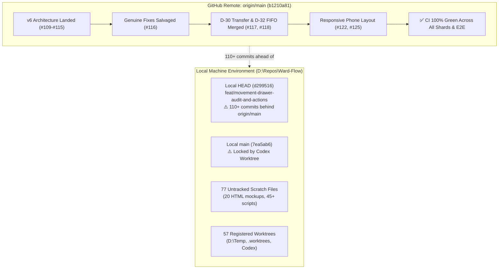

# Ward Flow — Comprehensive Repository Audit & Strategic Recommendations

**Document ID:** WF-AUDIT-20261009  
**Date:** 9 October 2026  
**Auditor:** Antigravity (Google DeepMind)  
**Target Repository:** [`BigSimmo/Ward-Flow`](file:///d:/Repos/Ward-Flow)  
**Canonical Baseline:** `origin/main` at commit [`b1210a81`](file:///d:/Repos/Ward-Flow)  
**Local Workspace State:** [`d299516`](file:///d:/Repos/Ward-Flow) on `feat/movement-drawer-audit-and-actions`  

---

## 1. Executive Summary & Context

**Ward Flow** is an operational psychiatric bed-flow coordination engine and clinical flight deck engineered specifically for Western Australia’s public mental health healthcare network (e.g. Fiona Stanley Hospital, Sir Charles Gairdner Hospital, Graylands Hospital, Royal Perth Hospital, Bentley, Midland, Rockingham, and regional catchments).

It is governed by three non-negotiable operational principles:
1. **100% Synthetic Demonstration Data:** Zero live electronic health record (EHR) connections, zero real patient information, and zero automated clinical decision-making.
2. **Clinician Always in the Loop:** The system never algorithmically allocates an inpatient bed or overrides clinical gatekeeping. It illuminates options, models constraints, and records human rationale.
3. **Truthful Denominators ("Stop the claim, keep the facts"):** The software never displays what data cannot support—no computed legal expiry deadlines, no phantom ready beds, and clear distinctions between "unrecorded" and "zero".

### The State of the Repository: A Tale of Two Realities

Our comprehensive adversarial review identified a stark contrast between the **published upstream repository** and the **local PC developer workspace**:

* **Upstream (`origin/main` at `b1210a81`) is in outstanding health:**
  Over the last 48 hours, the repository successfully landed the complete **v6 architecture overhaul** (PRs #109 through #115), phone responsive layout (#122, #125), two-way Figma token synchronization (#121), and critical clinical decisions: central coordinator inter-ward transfer gates (D-30, #117) and emergency FIFO queue triage ordering (D-32, #118). Furthermore, [PR #116](https://github.com/BigSimmo/Ward-Flow/pull/116) successfully salvaged all genuine bug fixes from older audit branches and merged them cleanly with passing tests. **Automated CI on `origin/main` is 100% green across all static checks, secret scans, 5 unit shards, 3 browser journey groups, and production builds.**
* **The local PC environment (`D:\Repos\Ward-Flow`) is heavily burdened by workspace debt:**
  The physical local checkout is parked on a dead, superseded branch (`feat/movement-drawer-audit-and-actions`) that is over 110 commits behind `origin/main`. Local `main` is locked by a stale Codex worktree; 77 untracked scratch files clutter the directory; and 57 worktrees are registered across the machine.



---

## 2. Inventory of Issues to Be Resolved

### Category 1: Immediate Local Workspace Debt (Actionable on this PC)

#### Issue 1.1: Local Primary Checkout Stranded on Dead Branch
* **Location:** [`D:\Repos\Ward-Flow`](file:///d:/Repos/Ward-Flow)
* **Status:** Critical Local Blocker
* **Context:** The working tree is currently checked out on branch `feat/movement-drawer-audit-and-actions` at commit `d299516`. This branch was part of [PR #108](https://github.com/BigSimmo/Ward-Flow/pull/108), which has been officially closed and superseded by PR #116. This branch is 110+ commits behind `origin/main` and contains obsolete code, broken tests, and merge conflicts.
* **Remediation:** Switch the local repository checkout to `main` and fast-forward to `origin/main`.

#### Issue 1.2: Local `main` Branch Locked by Stale Codex Worktree
* **Location:** `C:\Users\joshs\Documents\Codex\2026-10-05\task\ward-local-main`
* **Status:** Blocker for standard Git workflows
* **Context:** Attempting to run `git checkout main` in `D:\Repos\Ward-Flow` fails with Git's fatal error: `fatal: 'main' is already checked out at 'C:/Users/joshs/Documents/Codex/2026-10-05/task/ward-local-main'`. Local `main` is frozen at commit `7ea5ab6` (PR #62 from 5 October 2026).
* **Remediation:** Remove or detach the worktree registration at `C:\Users\joshs\Documents\Codex\2026-10-05\task\ward-local-main`, then pull `origin/main`.

#### Issue 1.3: 77 Untracked Scratch Files Cluttering Working Copy
* **Location:** `D:\Repos\Ward-Flow\` (Root, `public/`, and `scripts/`)
* **Status:** Workspace Hygiene Hazard
* **Context:** The working copy contains 77 untracked files left behind by previous autonomous coding sessions:
  * **20 standalone HTML mockups in `public/`:** E.g. `public/delays-header-options.html`, `public/ward-home-beds-mockup.html`, `public/delays-mockup-catchment.html`, `public/delays-mockup-runway.html`, `public/referral-inspector-mockup.html`. These violate the product owner's explicit mandate of 5 October 2026: *"Build interactive Ward Flow mockups in React and TypeScript using the site's existing Next.js routes, reusable components and CSS Modules... do not create a separate HTML/JavaScript UI that must be rewritten."*
  * **45+ single-use capture and crop scripts in `scripts/`:** E.g. `scripts/capture-all-parts-showcase.mjs`, `scripts/analyze-bottom-curvature.mjs`, `scripts/crop-ooa-bottom.mjs`, `scripts/apply-flightdeck.mjs`.
  * **4 stray diagnostic files in root:** `audit-buttons.mjs`, `audit-results.json`, `related-tests-report.json`, `tests_ward_list.txt`.
* **Remediation:** Safely delete or archive all 77 untracked files and update `.gitignore` so temporary visual test outputs are not tracked.

#### Issue 1.4: 57 Registered Git Worktrees Across Storage Drives
* **Location:** `D:\Repos\Ward-Flow\.worktrees\`, `D:\Temp\`, and `C:\Users\joshs\Documents\Codex\`
* **Status:** Disk overhead and branch-locking hazard
* **Context:** Git is maintaining tracking references to 57 distinct worktrees:
  * 12 worktrees in `D:\Repos\Ward-Flow\.worktrees\` (e.g. `remediation-master`, `fe-remediation`, `capacity-map`, `wf-pr12-unblock`).
  * 22 worktrees in `D:\Temp\` (e.g. `D:\Temp\ward-handover-overhaul-pr`, `D:\Temp\wt-pr33`, `D:\Temp\ward-combined-app-fixes-20261006`).
  * 12 worktrees in `C:\Users\joshs\Documents\Codex\...`
  * Under the **Dev Drive Deletion Safeguard (Recorded 2026-09-26)**, no file or folder under `D:\Worktrees` or `D:\Repos` can be deleted without Josh's explicit, itemized item-by-item approval.
* **Remediation:** Present an itemized pruning list of stale, merged worktrees to Josh for explicit approval.

---

### Category 2: Repository Tooling & Maintenance Debt

#### Issue 2.1: 159 Maintenance & Gate Scripts (Meta-Tooling Bloat)
* **Location:** [`scripts/`](file:///d:/Repos/Ward-Flow/scripts)
* **Status:** Maintenance Overhead & Build Brittleness
* **Context:** The repository contains 159 custom scripts and 117 npm script definitions in [`package.json`](file:///d:/Repos/Ward-Flow/package.json). Many scripts perform recursive self-testing (`--self-test`) on other scripts. When internal documentation or directory layouts are adjusted, circular test failures occur (e.g., [`check-dead-code-candidate.mjs`](file:///d:/Repos/Ward-Flow/scripts/check-dead-code-candidate.mjs) crashed because its test fixture did not anticipate the addition of `"docs/ward-flow/plans"`).
* **Remediation:** Consolidate bespoke gate scripts into standard ESLint rules, TypeScript configurations, and native Vitest suites. Retire single-use diagnostic scripts.

#### Issue 2.2: 25+ Stale Remote Feature Branches on GitHub
* **Location:** Remote `origin` (`https://github.com/BigSimmo/Ward-Flow.git`)
* **Status:** Remote Repository Clutter
* **Context:** Dozens of abandoned remote branches (such as `origin/cursor/ward-home-redesign-fdf6`, `origin/claude/v6-community`, `origin/codex/referral-drawer`, `origin/feat/movement-drawer-audit-and-actions`) remain active on GitHub despite their underlying features being merged or superseded.
* **Remediation:** Run a remote branch audit to prune merged branches while preserving active release tags.

#### Issue 2.3: Missing `docs/outstanding-issues.md`
* **Location:** [`docs/`](file:///d:/Repos/Ward-Flow/docs)
* **Status:** Developer Skill Failure
* **Context:** Several Antigravity and Claude Code skills (e.g. `/issues`, `/ledger`) look for `docs/outstanding-issues.md` to track unresolved technical items across sessions. The file does not exist on disk, causing commands referencing it to fail.
* **Remediation:** Instantiate a canonical `docs/outstanding-issues.md` linking directly to the status and decision logs.

---

### Category 3: Clinical Safety & Product Governance Gaps

#### Issue 3.1: Re-Introduction of Assertive Statutory Wording by Autonomous Agents
* **Location:** UI Screen Components (e.g. Movement Drawer, Legal Forms)
* **Status:** High Clinical/Legal Risk (Mitigated by Scanner, but recurring)
* **Context:** Under [Decisions D-5, D-22, and D-37](file:///d:/Repos/Ward-Flow/docs/ward-flow/decisions.md), Ward Flow is strictly prohibited from claiming statutory authority under the *Mental Health Act 2014* (WA). The software displays clinician-recorded dates and advisory countdowns, but never computes binding legal expiry or asserts enforcement consequences. In PR #108, an AI agent re-introduced `"Required under MHA 2014"` in [`movement-drawer.tsx`](file:///d:/Repos/Ward-Flow/src/components/ward-management/movements/movement-drawer.tsx#L819). While [`scripts/ward-flow/check-ward-legal-language.mjs`](file:///d:/Repos/Ward-Flow/scripts/ward-flow/check-ward-legal-language.mjs) caught the error, AI agents repeatedly attempt to re-add statutory chrome.
* **Remediation:** Add clear developer instructions and a pre-commit lint check emphasizing that form numbers (e.g. Form 1A, Form 4A) are approved descriptive terms, but statutory assertions ("MHA 2014", "Statutory Deadline Passed") are strictly prohibited.

#### Issue 3.2: Single-Browser In-Memory State Isolation (Decision D-18)
* **Location:** Application State Architecture ([`useDirtyStateGuard.ts`](file:///d:/Repos/Ward-Flow/src/components/ward-management/shell/useDirtyStateGuard.ts))
* **Status:** Operational Limitation for Demonstrations
* **Context:** Under Decision D-18, Ward Flow enforces a strict privacy doctrine: *"typed text stays off the device"*. To ensure zero leakage of simulated patient data, the application disables all browser caching (`sessionStorage`) the moment free text is typed. Consequently, scenario data cannot survive across browser tabs, and two clinicians sitting at different computers cannot see the same live board.
* **Remediation:** Keep D-18 intact for unauthenticated browser storage, but build the authenticated real-time synchronization backend (Milestone 5) so multi-user state can be coordinated safely over a secure WebSocket or server-sent event stream.

#### Issue 3.3: Disconnected Azure Cloud Backend
* **Location:** [`backend/ward-flow/`](file:///d:/Repos/Ward-Flow/backend/ward-flow)
* **Status:** Architectural Incompletion
* **Context:** The repository contains a fully implemented, tested Azure Functions and scenario storage backend in `backend/ward-flow`. It supports optimistic concurrency (`expectedRevision`), event sourcing, and synthetic scenario vaults. However, it is intentionally disconnected from the Next.js frontend awaiting the WF-29 privacy and multi-tenant access review.
* **Remediation:** Complete the WF-29 service-scoped access control specification and wire the frontend scenario sync to the backend API behind an optional environment flag.

#### Issue 3.4: Drift of Live Hosted Railway Production Site
* **Location:** `https://ward-flow-production.up.railway.app/`
* **Status:** Outdated Stakeholder Showcase
* **Context:** The public demonstration environment on Railway has not been updated since the v6 phone layout and design overhauls were merged onto `main`. External stakeholders accessing the live URL are viewing an older layout.
* **Remediation:** Once local synchronization is verified, trigger an authorized production redeployment to Railway.

#### Issue 3.5: All 30 Clinical Screens Universally Exposed (Lack of RBAC Switcher)
* **Location:** [`src/components/ward-management/shell/`](file:///d:/Repos/Ward-Flow/src/components/ward-management/shell)
* **Status:** User Experience Friction for Hospital Executives
* **Context:** Under Decision D-37, the clinical governance posture ratifies 4 distinct operational roles:
  1. *Statewide Bed Coordinator*
  2. *Inpatient Nurse Unit Manager (NUM)*
  3. *Emergency Department Psychiatric Liaison*
  4. *Executive / Operations Director*
  Currently, all 30 screens and drawers are visible to any user via the main navigation bar. In real clinical demonstrations, this creates visual clutter and information overload.
* **Remediation:** Implement an interactive "Role Switcher" in the top bar that filters available screens, queues, and notifications to match the selected clinical persona.

#### Issue 3.6: Manual Demonstration Friction
* **Location:** [`docs/ward-flow/DEMO-SCRIPT.md`](file:///d:/Repos/Ward-Flow/docs/ward-flow/DEMO-SCRIPT.md)
* **Status:** Presenter Cognitive Load
* **Context:** The project has an exemplary 10-minute demonstration script spanning 5 clinical acts (Morning Statewide Handover, Acute ED Referral Arrival, Non-algorithmic Bed Allocation under D-32, Inter-Ward Transfer Gate under D-30, and Surge/Delays Runway Escalation). Executing this demo currently requires the presenter to memorize every click, drawer opening, and scenario reset.
* **Remediation:** Build an in-app "Guided Tour / Walkthrough Mode" (an interactive stepper) that advances the scenario and highlights relevant UI elements with contextual clinical cue cards.

#### Issue 3.7: 10 Formally Parked Pre-Pilot External Governance Gates
* **Location:** [`docs/ward-flow/decisions.md`](file:///d:/Repos/Ward-Flow/docs/ward-flow/decisions.md#d-36-affirmation-of-external-governance--clinical-safety-hard-gates-6-october-2026) (Decisions D-36 and D-37)
* **Status:** Known Strategic Pre-requisites (Parked by Design)
* **Context:** Ten external governance items cannot be resolved in code and remain parked hard gates before any real patient data or live hospital pilot at EMHS:
  1. *WF-29:* Multi-Tenant Azure Entra ID isolation.
  2. *WF-31 & WF-56:* WA State Solicitor's Office / Crown Law legal advice on MHA forms.
  3. *WF-33:* Multi-tenant production cloud database connection.
  4. *WF-44:* Live phone-verified statewide catchment and clinic directory.
  5. *WF-46:* Formal appointment of an Australian Clinical Safety Officer (CSO) and live hazard log.
  6. *WF-53:* Independent Aboriginal Cultural Safety Review.
  7. *WF-54:* Formal TGA Medical Device (SaMD) exemption filing.
  8. *WF-55:* External Privacy Impact Assessment (PIA).
  9. *WF-57:* Post-Incident Review (PIR) tamper-evident chronology export.
  10. *Internal Patient Codes Decision (OA-58).*
* **Remediation:** Maintain these as parked gates until formal hospital pilot commissioning; assemble the "Pre-Pilot Briefing Dossier" for EMHS leadership.

---

## 3. Prioritized Strategic Recommendations

| Priority | Initiative | Scope | Primary Objective |
| :--- | :--- | :--- | :--- |
| **P0 (Immediate)** | **Workspace Sync & Worktree Release** | Local Machine | Unlock `main`, fast-forward to `b1210a81`, clean 77 untracked files. |
| **P1 (Near Term)** | **Interactive Guided Demo Stepper** | UI Feature | Embed an in-app runner for the 10-minute clinical demo script. |
| **P2 (Near Term)** | **Clinical Role Switcher (RBAC)** | Navigation | Filter screens by 4 clinical personas (Coordinator, NUM, ED, Executive). |
| **P3 (Medium Term)** | **Multi-User Sync Layer (Milestone 5)**| Backend / UI | Real-time WebSocket/SSE state sharing across multiple physical screens. |
| **P4 (Medium Term)** | **Tooling & Script Rationalization** | DevEx / CI | Consolidate 159 scripts into standard ESLint/Vitest configurations. |
| **P5 (Pre-Pilot)** | **EMHS Stakeholder Dossier Assembly** | Governance | Package TGA exemption, CSO safety case, and KPI evaluation protocol. |

---

## 4. Immediate Step-by-Step Action Plan

To restore the local developer environment to 100% health without touching protected paths or deleting unapproved worktrees, execute the following four steps:

### Step 1: Detach the Stale Codex Worktree Locking `main`
```powershell
git worktree remove "C:\Users\joshs\Documents\Codex\2026-10-05\task\ward-local-main"
```
*(If the folder contains modified files or was already deleted manually, use `git worktree prune` to clean the registration).*

### Step 2: Switch the Primary Checkout to `main` and Pull Latest
```powershell
git checkout main
git pull origin main
```
*This fast-forwards your working copy from commit `7ea5ab6` directly to `b1210a81`, instantly adopting all v6 foundation improvements, phone responsive layouts, and passing tests.*

### Step 3: Remove the 77 Untracked Scratch Files
```powershell
# Remove temporary mockup HTMLs in public/
Remove-Item -Force public/*.html

# Remove one-off diagnostic and capture scripts in scripts/
Remove-Item -Force scripts/capture-*.mjs, scripts/analyze-*.mjs, scripts/crop-*.mjs, scripts/generate-*.mjs, scripts/check-*-html.mjs, scripts/diagnose-*.mjs, scripts/inspect-*.mjs, scripts/make-*.mjs, scripts/take-*.mjs, scripts/test-*-interactions.mjs, scripts/verify-*-perfection.mjs

# Remove stray root artifacts
Remove-Item -Force audit-buttons.mjs, audit-results.json, related-tests-report.json, tests_ward_list.txt
```

### Step 4: Verify Local Test Suite
```powershell
npx vitest run tests/ward-style-drift-ratchet.test.ts tests/dead-code-candidate.test.ts
npm run test:backend
```
*Confirms that local execution matches the 100% green status observed on GitHub CI.*
