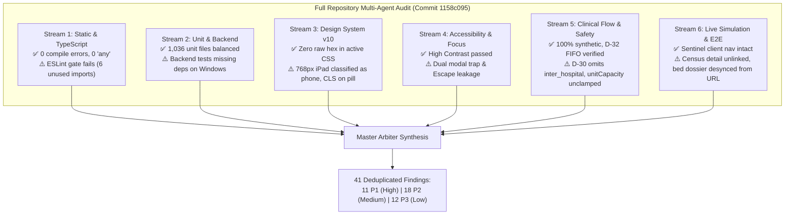

# Ward Flow — Comprehensive Full Repository Audit Report

**Document ID:** `WF-AUDIT-20261011`  
**Date:** 11 October 2026  
**Auditor Panel:** Antigravity Multi-Agent Parallel Audit Panel (6 Specialist Streams)  
**Target Repository:** [`BigSimmo/Ward-Flow`](file:///d:/Repos/Ward-Flow)  
**Canonical Baseline:** `origin/main` at commit [`1158c095`](file:///d:/Repos/Ward-Flow) (*"Phone screens match the v10 mockup, Prototype banner becomes a pill (#246)"*)  
**Execution Environment:** Isolated worktree `D:\Worktrees\WardFlow\repo-audit-20261011`  

---

## 1. Executive Summary & Quality Scorecard

An exhaustive, multi-agent adversarial audit of the entire Ward Flow codebase was conducted across **six concurrent specialist streams**:
1. **Static Analysis & TypeScript Strictness** (`Stream 1`)
2. **Test Architecture, Shards & Backend Safety** (`Stream 2`)
3. **Design System v10 & Responsive Viewports** (`Stream 3`)
4. **Accessibility (WCAG 2.1 AA) & UX Resilience** (`Stream 4`)
5. **Clinical Flow Truthfulness & Synthetic Data Compliance** (`Stream 5`)
6. **Live Simulation, E2E Journeys & Playwright Infrastructure** (`Stream 6`)



### High-Level Quality Verdict
- **Exceptional Architectural Foundations:** Full TypeScript strict-mode compilation (`npm run typecheck:ci`) passed with **0 errors**, and production source code contains **0 instances of `any`**. The client-side data layer is **100% synthetic**, strictly decoupled from live hospital EHRs, and governed by Default-Deny rule D-14.
- **Topological & Clinical Realism:** Accurately reflects Western Australia's public mental health healthcare network (FSH, SCGH, Graylands, RPH, Bentley, Midland, Rockingham, regional catchments) and statutory governance under the *Mental Health Act 2014* (WA).
- **Critical Actionable Regressions:** Eleven P1 issues require immediate remediation to unblock CI gates, restore core clinician navigation paths, prevent Cumulative Layout Shift (CLS), and fix tablet viewport layouts.

---

## 2. Master Severity Matrix

| Stream | Domain | P1 (High) | P2 (Medium) | P3 (Low) | Total |
| :--- | :--- | :---: | :---: | :---: | :---: |
| **S1** | Static Analysis & TypeScript | 3 | 4 | 4 | 11 |
| **S2** | Test Architecture & Backend | 2 | 3 | 3 | 8 |
| **S3** | Design System & Responsive | 2 | 2 | 2 | 6 |
| **S4** | Accessibility & Focus UX | 2 | 4 | 1 | 7 |
| **S5** | Clinical Flow & Synthetic Safety | 0 | 2 | 1 | 3 |
| **S6** | Live Simulation & E2E Journeys | 2 | 4 | 2 | 8 |
| **Total**| **Deduplicated Findings** | **11** | **18** | **12** | **41** |

---

## 3. High-Priority Defects (P1 — Immediate Fix Required)

### [WF-01] ESLint `--max-warnings 0` Gate Failure Blocks CI
- **Severity:** P1 (Build / Gate Blocker)
- **Streams:** S1
- **Files & Lines:**
  - [`src/components/ward-management/handover/handover-phone.tsx:13, 30, 35`](file:///d:/Repos/Ward-Flow/src/components/ward-management/handover/handover-phone.tsx#L13-L35) (`Count`, `rowTone`, `dueShort`)
  - [`src/components/ward-management/search/patient-census-view.tsx:17, 35`](file:///d:/Repos/Ward-Flow/src/components/ward-management/search/patient-census-view.tsx#L17-L35) (`History`, `Sheet`)
  - [`src/components/ward-management/statistics/statistics-summary-phone.tsx:9`](file:///d:/Repos/Ward-Flow/src/components/ward-management/statistics/statistics-summary-phone.tsx#L9) (`FactGrid`)
- **Defect:** Commit `1158c095` (PR #246) introduced six unused symbols. Running `npm run lint` fails with exit code 1 because `--max-warnings 0` is strictly enforced.
- **Reproducer:** `npm run lint`
- **Fix:** Remove the six unused import declarations.

---

### [WF-02] 768px iPad Portrait Viewport Misclassified as Phone
- **Severity:** P1 (Core Responsive Layout Broken)
- **Streams:** S3
- **File & Lines:** [`src/components/wf/use-is-phone.ts:6-10`](file:///d:/Repos/Ward-Flow/src/components/wf/use-is-phone.ts#L6-L10)
- **Defect:** `WF_PHONE_QUERY` is defined as `(max-width: 48rem)` (768px inclusive), while tablet portrait is `(min-width: 48.0625rem)`. At 768px (standard iPad Mini/Air portrait), `useIsPhone()` returns `true`, forcing the SVG-masked phone bottom dock, mobile headers, and single-column cards onto iPads instead of the tablet navigation rail and tablet layout.
- **Reproducer:** Open Chrome DevTools, set viewport to `768x1024`, and visit `/mockups/ward-flow`.
- **Fix:** Align breakpoint with fractional pixel boundaries:
  ```typescript
  export const WF_PHONE_QUERY = "(max-width: 47.9375rem)"; // 767px
  export const WF_TABLET_PORTRAIT_QUERY = "(min-width: 48rem) and (max-width: 62.5rem)"; // 768px to 1000px
  ```

---

### [WF-03] Hydration Cumulative Layout Shift (CLS) via Deferred Prototype Pill Slot
- **Severity:** P1 (User-Perceived Layout Jolt)
- **Streams:** S3
- **File & Lines:** [`src/components/ward-management/ward-shared-access.tsx:185, 203-214, 230-258`](file:///d:/Repos/Ward-Flow/src/components/ward-management/ward-shared-access.tsx#L185-L258)
- **Defect:** On SSR and initial client frame, `slot` is `null`, so `WardSharedAccess` renders a standalone 50px `<section className={styles.toolbar}>` banner above the shell, setting `--wf-data-bar-height: 50px`. When `WardDataModeSlot` mounts inside `WardBar`, the banner unmounts and portals the pill into the top bar, resetting `--wf-data-bar-height` to `0px`. The entire page content jumps upward by 50px on every route load.
- **Reproducer:** Load `/mockups/ward-flow` with 4x CPU slowdown and observe the top layout shift.
- **Fix:** Mount `<DataModePill>` directly inside `WardBar` without rendering the transient top toolbar during SSR.

---

### [WF-04] Admitted Census Detail Missing Action Link (Clinician Journey Dead-End)
- **Severity:** P1 (Clinician Workflow Dead-End)
- **Streams:** S6
- **File & Lines:** [`src/components/ward-management/search/patient-census-view.tsx:779-792`](file:///d:/Repos/Ward-Flow/src/components/ward-management/search/patient-census-view.tsx#L779-L792)
- **Defect:** When searching an admitted inpatient (`row.kind === "admission" && row.group === "ward"`), `CensusDetail` displays their ward name in the facts table, but the action slot is `null`. Clinicians have no link or button to jump to the ward or view the bed dossier.
- **Reproducer:** Go to `/mockups/ward-flow/census`, search for an admitted patient, and open the drawer. The action button area is blank.
- **Fix:** Render an action button linking to `/mockups/ward-flow/ward/${row.unitId}?bed=${row.bedIndex}`.

---

### [WF-05] Bed Dossier Drawer & Search Desynchronized from Browser Back Navigation
- **Severity:** P1 (Context Loss / Accidental Page Departure)
- **Streams:** S6
- **Files & Lines:** [`src/components/ward-management/ward/ward-screen.tsx:316`](file:///d:/Repos/Ward-Flow/src/components/ward-management/ward/ward-screen.tsx#L316), [`src/components/ward-management/search/patient-search.tsx:120-145`](file:///d:/Repos/Ward-Flow/src/components/ward-management/search/patient-search.tsx#L120-L145)
- **Defect:** `selectedBed` is held in local React state without URL synchronization (`?bed=XX`). Pressing the browser Back button while inspecting a bed navigates the user completely away from the ward screen rather than closing the drawer.
- **Reproducer:** Navigate to `/mockups/ward-flow/ward/bentley-assessment`, click Bed 4 to open the dossier drawer, and click browser Back. The entire page navigates away.
- **Fix:** Sync `selectedBed` with URL searchParams (`?bed=XX`) or integrate with `window.history.pushState`.

---

### [WF-06] Double Modal Stack Registration & Escape/Tab Conflict in `WardTasksDrawer`
- **Severity:** P1 (Accessibility & Keyboard Trapping Conflict)
- **Streams:** S4
- **Files & Lines:** [`src/components/ward-management/ward-tasks-drawer.tsx:189`](file:///d:/Repos/Ward-Flow/src/components/ward-management/ward-tasks-drawer.tsx#L189), [`src/components/ward-management/shell/ward-bar.tsx:1894`](file:///d:/Repos/Ward-Flow/src/components/ward-management/shell/ward-bar.tsx#L1894)
- **Defect:** `WardTasksDrawer` unconditionally calls `useWardModalFocus(true, drawerRef, onClose)`. When opened inside `<Sheet withBackdrop ...>`, both `Sheet` and `WardTasksDrawer` register on the modal stack and attach separate Escape and Tab event listeners, causing duplicate closes and erratic focus loop jumps.
- **Fix:** Pass `withBackdrop` into `useWardModalFocus(withBackdrop, drawerRef, onClose)`.

---

### [WF-07] Escape Key Leakage Closes Foreground Sheet AND Background Dossier
- **Severity:** P1 (Keyboard Navigation Collision)
- **Streams:** S4
- **Files & Lines:** [`src/components/ward-management/ward/ward-screen.tsx:509-535`](file:///d:/Repos/Ward-Flow/src/components/ward-management/ward/ward-screen.tsx#L509-L535), [`src/components/ward-management/delays/delays-board.tsx:1099-1112`](file:///d:/Repos/Ward-Flow/src/components/ward-management/delays/delays-board.tsx#L1099-L1112)
- **Defect:** Raw window `keydown` listeners on Escape do not check `event.defaultPrevented` or `isTopmostSheet()`. When a top navigation Sheet (e.g. Tasks) is opened over a selected bed, pressing Escape closes both Tasks and the Bed Dossier simultaneously.
- **Fix:** Add `if (event.defaultPrevented || document.querySelector('[data-wf-sheet-surface]')) return;` to background Escape handlers.

---

### [WF-08] Backend Dependencies Missing (`ERR_MODULE_NOT_FOUND`)
- **Severity:** P1 (Test & Backend Execution Blocker)
- **Streams:** S2
- **Files & Lines:** [`backend/ward-flow/package.json:20-29`](file:///d:/Repos/Ward-Flow/backend/ward-flow/package.json#L20-L29), [`backend/ward-flow/function.mjs:1`](file:///d:/Repos/Ward-Flow/backend/ward-flow/function.mjs#L1)
- **Defect:** `backend/ward-flow` is not declared as a workspace in root `package.json`, and its packages (`@azure/functions`, `@azure/identity`, `pg`) are not installed. Running `npm run test:backend` crashes with `ERR_MODULE_NOT_FOUND` on 12 of 23 tests.
- **Reproducer:** `npm run test:backend`
- **Fix:** Add `"backend/ward-flow"` to `workspaces` in root `package.json`.

---

### [WF-09] Windows-Incompatible Mock CLI in `azure-setup.test.mjs`
- **Severity:** P1 (Windows CI / Dev Test Failure)
- **Streams:** S2
- **File & Lines:** [`backend/ward-flow/azure-setup.test.mjs:79-88`](file:///d:/Repos/Ward-Flow/backend/ward-flow/azure-setup.test.mjs#L79-L88)
- **Defect:** Creates an extensionless mock script `az` using the POSIX delimiter `PATH: \`\${folder}:\${PATH}\``. On Windows, extensionless files are ignored by `spawnSync("az", ...)`, causing tests to fall through to the real Azure CLI and fail 9 tests.
- **Fix:** Use `az.cmd` on `win32` with `path.delimiter`.

---

## 4. Medium-Priority Defects (P2 — Functional, Ergonomic & Domain Types)

1. **[WF-10] `HomeRegion` Double-Cast (`as unknown as string === "Community"`):** Repeated 11 times across search modules (`patient-search.tsx`, `record-preview.tsx`, `search-filters.ts`) because `"Community"` is not in `HOME_REGIONS` (it is a referral source). Replace with `referral.source === "community"`. *(Stream 1)*
2. **[WF-11] Unsound Event Log Cast (`entry as unknown as WardFlowEvent`):** In `ward-event-log.ts:60`, stripped-down `EventLogEntry` objects are cast directly to `WardFlowEvent`, creating runtime `undefined` hazards for event payloads. *(Stream 1)*
3. **[WF-12] Dynamic Clinical Field Bypass on `Patient`:** In `ward-patients.ts:372-373`, `Patient` is cast to `Record<string, ...>` to access unmodeled clinical free-text fields (`primaryDiagnosis`, `clinicalNotes`), circumventing synthetic privacy model boundaries. *(Stream 1)*
4. **[WF-13] Unlisted Phantom Dependency (`parse5`):** Imported in `tests/ward-landmarks.test.ts:12` without being listed in `devDependencies` in `package.json`. *(Stream 1)*
5. **[WF-14] Outdated & Contradictory SQL Schema Relic:** `backend/ward-flow/schema.sql` defines an abandoned demo session table out of sync with active migrations `001..003.sql`. *(Stream 2)*
6. **[WF-15] 55 Obsolete Monorepo Tests Permanently Skipped:** `tests/ci-cache-safety.test.ts` references the legacy monorepo workflow `.github/workflows/ci.yml` (superseded by `ward-flow.yml`), skipping 55 tests for removed PsychSift components. *(Stream 2)*
7. **[WF-16] Fragile Millisecond `setTimeout` Timers in DOM Focus Tests:** DOM unmount and focus restoration tests in `sheet-focus-stress.dom.test.tsx` rely on fixed timers (`40ms`–`120ms`) susceptible to race conditions. Replace with `waitFor()`. *(Stream 2)*
8. **[WF-17] Hero Band Bleed Post-Mount Layout Shift:** `useWfBandBleed` uses `useLayoutEffect` DOM measurements, causing heroes to render initially as inset rounded cards before snapping outward to negative margins and flipping `WardBar` to dark slate. *(Stream 3)*
9. **[WF-18] Hardcoded Hex Colors & Sub-12px Font Sizes in Secondary Interfaces:** `ward-arrivals-corridor.tsx` uses 11px font sizes and 28px buttons; `upload-forms-modal.tsx` uses hardcoded hex colors (`#16a34a`, `#0284c7`). *(Stream 3)*
10. **[WF-19] Missing `tabIndex={-1}` on Modal Root Containers:** `arrival-time-modal.tsx`, `reset-baseline-modal.tsx`, and `ward-bed-dossier-drawer.tsx` fail to set `tabIndex={-1}` on root containers, causing fallback `.focus()` calls to silently fail. *(Stream 4)*
11. **[WF-20] Incomplete Focusable Selector in `useWardModalFocus`:** Does not exclude `button[tabindex="-1"]` or `[aria-hidden="true"]`, causing focus to land on invisible collapsed sections. *(Stream 4)*
12. **[WF-21] Ad-Hoc Inline Modals Missing Background Inerting:** Inline dialogs in `ward-board.tsx:3206` render without `<OverlayPortal>` or background inerting, allowing Tab navigation to leak behind backdrops. *(Stream 4)*
13. **[WF-22] Tab-Scoped Rendering Silences Statewide Alerts:** Broadcast alert banner in `alerts-screen.tsx` is only mounted when `tab === "broadcast"`, failing to announce critical emergency directives when clinicians view active alerts or notices. *(Stream 4)*
14. **[WF-23] `unitCapacity` Derivation Enables Phantom Ready Beds:** In `ward-derivations.ts:582-584`, `available` is not clamped to `unit.beds`. On 0-bed or unstaffed units reporting empty counts, `available + held` can exceed physical bed capacity. *(Stream 5)*
15. **[WF-24] Inter-Hospital Transfers Bypass Decision D-30 Coordinator Gate:** `wardTransferNeedsCoordinator` in `ward-referrals.ts` strictly checks `referral.source === "psychiatric_ward"`, omitting `source: "inter_hospital"`. Transfers from outer general hospital wards bypass the coordinator gate. *(Stream 5)*
16. **[WF-25] Ward Screen Tab Navigation Desynchronized from URL:** Tab switching (`board`, `coming`, `out`, `beds`, `return`) does not update the browser URL, resetting clinicians to the default tab on page refresh. *(Stream 6)*
17. **[WF-26] WardBar Drawer Route Race Condition:** Clicking internal links inside a popover can cause `window.history.back()` to race against Next.js route navigation, intermittently trapping the clinician on the existing page. *(Stream 6)*
18. **[WF-27] React 19 Streaming Staging Collision:** Initial HTML chunks stream into `<div hidden id="S:0">`, causing duplicate locator resolution in tests before `$RC` hydration concludes. *(Stream 6)*

---

## 5. Low-Priority Defects (P3 — Technical Debt & Hygiene)

1. **[WF-28] Stale Window Pollution in `CommunityScreen`:** Attaches component setters (`win.switchTab`) to `window` without `useEffect` cleanup. *(Stream 1)*
2. **[WF-29] Unused Production Dependency (`server-only`):** Declared in `dependencies` in `package.json` but never imported in `src/`. *(Stream 1)*
3. **[WF-30] Non-Null Assertion Overuse:** 35+ instances of `!` where standard array `.filter()` calls fail to narrow TypeScript types. *(Stream 1)*
4. **[WF-31] Historical `bundle-budget.json` Absence:** Absent from repository root; document that it was a historical PsychSift artifact. *(Stream 1)*
5. **[WF-32] Leading Slash in Windows Vitest Alias:** `vitest.config.mts` uses `.pathname` which produces `/D:/...` on Windows. *(Stream 2)*
6. **[WF-33] Shard Latency Bottlenecks:** Legal figure sweep tests account for 25% of each CI shard's duration (~150s each). *(Stream 2)*
7. **[WF-34] Vitest CLI Defaults to Thread Pool:** Standard `npm test` runs default to Vitest threads pool rather than `forks`. *(Stream 2)*
8. **[WF-35] Sub-44px Touch Target on Movement Cockpit BackLink:** Sized at `32x32px` without hit-target expansion. *(Stream 3)*
9. **[WF-36] Referral Drawer Width Oversized at 768px Tablet Portrait:** Sized at `min(100vw - 1.5rem, 64rem)`, covering 96.8% of the screen. *(Stream 3)*
10. **[WF-37] Missing Actionable Recovery on Zero-Match Movements:** Renders zero-match text without a "Clear search" button. *(Stream 4)*
11. **[WF-38] Frankland Centre Omitted from `STANDARD_WARD_SITES`:** State forensic mental health facility at Graylands is missing from default ward sites. *(Stream 5)*
12. **[WF-39] Ward Flow E2E Tests Excluded from Default PR Verification Shards:** Excluded from `test:e2e:pr` in `playwright-pr-shards.mjs`. *(Stream 6)*

---

## 6. Verified Architectural Strengths & Passing Gates

1. **TypeScript Strictness (100% Pass):** Zero compiler errors under strict mode (`npm run typecheck:ci`). Zero instances of `any` across production source code.
2. **Synthetic Data Compliance & Zero EHR Calls:** Strict adherence to synthetic patient generation; zero live EHR endpoints (no FHIR, HL7, webPAS, PSOLIS). Outgoing payloads protected by `synthetic-data-guard.ts`.
3. **Default-Deny Patient Linkage (Rule D-14):** 4/4 passing tests enforcing that unauthorized components cannot access raw patient IDs.
4. **Emergency FIFO Triage Sequence (Decision D-32):** Chronological queue ordering strictly maintained by elapsed waiting time; ATS categories rendered as visual indicators without queue jumping.
5. **Truthful Denominators ("Stop the claim, keep the facts"):** Zero computed statutory deadlines under the WA Mental Health Act 2014; all limits marked as untrusted manual transcriptions.
6. **Windows High Contrast Mode (WCAG 2.1 AA):** Verified with Playwright tests (`tests/ui-ward-forced-colors.spec.ts`) asserting 1px system borders and >=4.5:1 text contrast.
7. **WAI-ARIA Sheet Architecture:** Gold-standard sheet stack management in `sheet.tsx` with background inerting and late return focus resolution.
8. **Greedy LPT CI Sharding:** 1,036 unit test files balanced across 8 shards with variance under 0.1s.

---

## 7. Recommended Remediation Roadmap

To resolve all identified issues safely, remediation should be executed in **four independent, scoped PR batches**:

### Batch 1: Immediate CI & Layout Gates (P1 Quick Wins)
- Remove unused imports in `handover-phone.tsx`, `patient-census-view.tsx`, and `statistics-summary-phone.tsx` (fixes `npm run lint`).
- Fix `WF_PHONE_QUERY` in `use-is-phone.ts` (`max-width: 47.9375rem`) to restore iPad 768px tablet layout.
- Eliminate prototype pill hydration CLS in `ward-shared-access.tsx`.
- Wire `backend/ward-flow` into root workspaces and add Windows-aware executable mock in `azure-setup.test.mjs`.

### Batch 2: Clinician Navigation & Accessibility Safety (P1/P2)
- Wire `patient-census-view.tsx` admitted patient action button to navigate directly to ward/bed.
- Sync `selectedBed` with URL searchParams (`?bed=XX`) for browser Back button support.
- Fix double modal registration in `ward-tasks-drawer.tsx` and guard Escape keydown listeners.
- Add `tabIndex={-1}` to modal root containers and exclude `button[tabindex="-1"]` from focusable selectors.

### Batch 3: Clinical Truthfulness & Domain Typing (P2)
- Widen `wardTransferNeedsCoordinator` to cover `source: "inter_hospital"`.
- Clamp `available` and `held` to `unit.beds` in `unitCapacity()`.
- Replace 11 occurrences of `(referral.homeRegion as unknown as string) === "Community"` with domain `referral.source === "community"`.
- Clean up `EventLogEntry` cast in `ward-event-log.ts`.

### Batch 4: Test Infrastructure & Style Hygiene (P3)
- Prune obsolete monorepo tests in `ci-cache-safety.test.ts`.
- Replace millisecond sleeps in `sheet-focus-stress.dom.test.tsx` with condition-based waiting (`waitFor`).
- Extract inline styles in `ward-arrivals-corridor.tsx` and `upload-forms-modal.tsx` to CSS modules with v10 tokens.
- Add Frankland Centre to Graylands Hospital in `STANDARD_WARD_SITES`.
